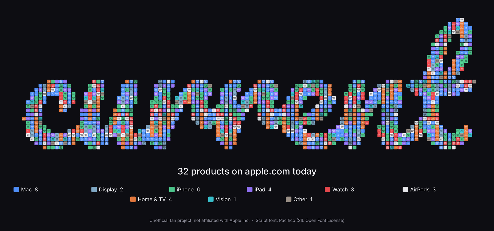
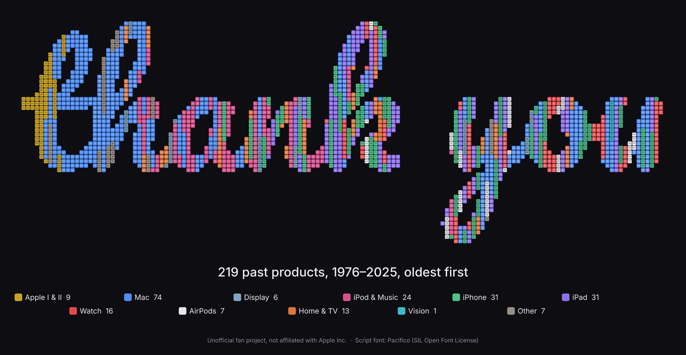

# Apple Fill

Two words written in script and filled with Apple products. **current** is filled with everything Apple sells today. **thank you** is filled with every product Apple has retired, from the Apple I in 1976 onward, in release order from left to right.

The full-size images are over 10,000 pixels wide, so you can zoom in and find individual products.





Full-size, zoomable versions: [current.jpg](output/current.jpg) and [thank_you.jpg](output/thank_you.jpg).

## How it works

1. **The data** lives in [`data/products.json`](data/products.json). Each product has a name, a category, a release month, and a `current` flag that says whether apple.com still sells it new.
2. **The words** are set in [Pacifico](https://fonts.google.com/specimen/Pacifico), an open-source script font included in `assets/fonts`.
3. **The tiles** fill each word completely. The script picks a tile size small enough for the letters to stay readable, then fits exactly that many square tiles inside the word with no empty slots.
4. **The order** follows the word from left to right. In **thank you**, each past product gets a short run of neighboring tiles, oldest first, so the word reads as a timeline. **current** has fewer products than tiles, so the lineup repeats along the word.
5. **The photos** come from Wikimedia Commons, the free media library behind Wikipedia. Each tile shows its product's photo in a frame of its category color. Products without a freely licensed photo show their name on a colored tile instead. Every photo is credited in [CREDITS.md](CREDITS.md).
6. **The weekly update** runs on GitHub Actions every Monday. It checks Wikipedia for new releases, checks apple.com for the current lineup, downloads any missing photos, redraws the images, and opens a pull request for review. When Apple retires a product, it moves from **current** to **thank you** automatically.

### What counts as a product

- Apple-branded hardware: computers, phones, tablets, watches, audio, home devices, displays, and a few historical oddities such as the Newton and QuickTake.
- Variants released together share one entry (for example, "iPhone 17 Pro / Pro Max").
- Accessories (keyboards, mice, pencils, cases, bands, cables) and third-party products are excluded. Beats products are excluded as well.

## Run it on your Mac

```bash
git clone https://github.com/ericjbolt/apple-fill.git
cd apple-fill
python3 -m venv .venv && source .venv/bin/activate
pip install -r requirements.txt

python scripts/fetch_images.py             # download product photos and credits
python scripts/render.py                   # redraw both words
python scripts/fetch_current.py --dry-run  # preview apple.com lineup changes
python scripts/fetch_all_time.py --dry-run # preview new releases from Wikipedia
```

Images are written to the `output` folder: a large `.jpg` for zooming and a smaller `.png` preview for each word.

## Editing the data by hand

Open `data/products.json` and add, remove, or correct a product. Then run `python scripts/render.py` and commit the result.

| Field | Meaning |
| --- | --- |
| `name` | Name shown on the tile when there is no photo |
| `line` | Product family, such as "MacBook Air", used to match apple.com |
| `category` | One of the legend categories, which sets the tile color |
| `date` | Announcement or release month, as `YYYY-MM` |
| `current` | `true` places the product in **current**, `false` in **thank you** |
| `apple_name` | Optional. The exact name apple.com uses, such as "iPhone 17e" |
| `image_file` | Optional. A specific Wikimedia Commons file to use as the photo, such as "iPhone 4 Black.jpg" |
| `needs_review` | Added by the update scripts. Check the entry, then delete this field |

## Repository structure

```
apple-fill/
├── data/products.json          the product list
├── data/photo_credits.json     author, license, and source for each photo
├── scripts/render.py           draws both words
├── scripts/fetch_current.py    syncs the current lineup with apple.com
├── scripts/fetch_all_time.py   adds new releases from Wikipedia
├── scripts/fetch_images.py     downloads product photos and writes CREDITS.md
├── scripts/common.py           shared helpers and the color palette
├── assets/fonts/               Pacifico script font and its license
├── assets/photos/              downloaded product photos
├── tests/test_scripts.py       offline tests
├── output/                     generated images
└── .github/workflows/update.yml
```

## Notes

- The weekly job needs permission to open pull requests. In the repository on GitHub, go to **Settings > Actions > General**, choose **Read and write permissions**, and check **Allow GitHub Actions to create and approve pull requests**.
- To run the update immediately, open the **Actions** tab, choose **Weekly product update**, and click **Run workflow**.
- The apple.com and Wikipedia readers depend on how those pages are built. If either page changes, the script stops without writing anything, and the weekly pull request simply will not appear. The images stay correct either way.
- The photo script uses the lead photo from each product's Wikipedia article. When an article covers several models, the photo may show a sibling model. To choose a specific photo, add an `image_file` field to that product, delete its file from `assets/photos`, and rerun `python scripts/fetch_images.py`.
- Only photos licensed CC BY, CC BY-SA, CC0, or public domain are accepted. The script checks each license on Wikimedia Commons before downloading, and it skips logos and screenshots.

## Disclaimer

This is an unofficial fan project. It is not affiliated with, endorsed by, or sponsored by Apple Inc. Apple product names are trademarks of Apple Inc., used here only to identify the products.

## License

The code is released under the MIT License. See [LICENSE](LICENSE).

The images in the `output` folder include product photos from Wikimedia Commons, some under Share-Alike licenses, so those images are released under [CC BY-SA 4.0](https://creativecommons.org/licenses/by-sa/4.0/). Each photo keeps its original license, listed in [CREDITS.md](CREDITS.md).

The Pacifico font is licensed under the SIL Open Font License 1.1. See [assets/fonts/OFL.txt](assets/fonts/OFL.txt).
