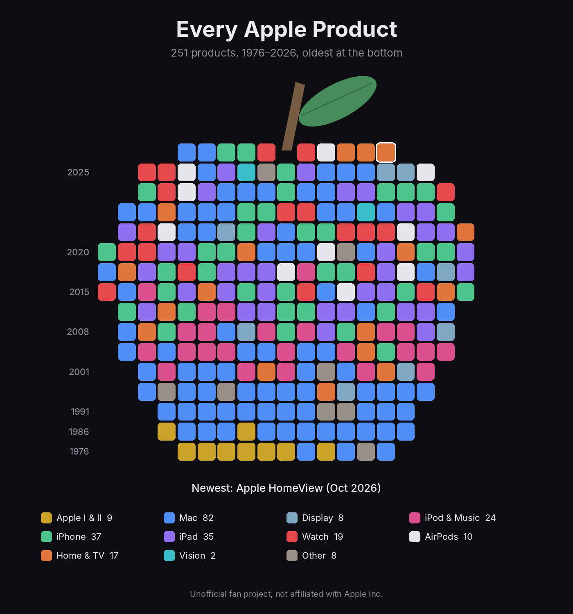
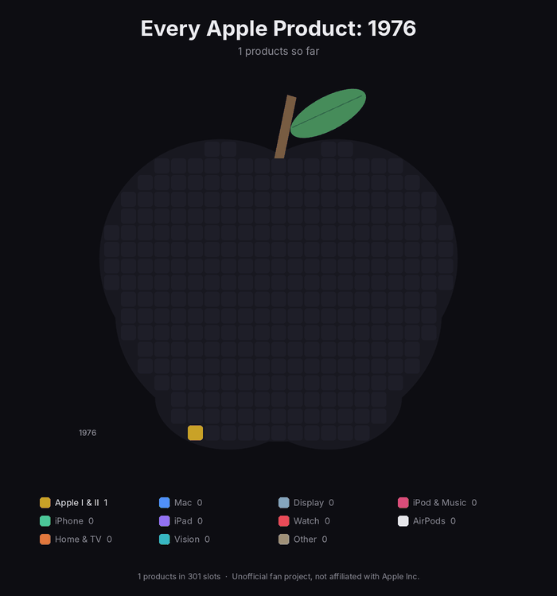

# Apple Fill

Every Apple product, in release order, stacked from the bottom up into the shape of an apple. There is no outline and no empty space: the tiles themselves form the apple. When Apple releases something new, every tile shrinks slightly to make room, and the apple is full again.

There are two versions:

| Every product, 1976 to today | The current lineup on apple.com |
| --- | --- |
|  |  |

And the whole history as an animation, one frame per year, with the tiles shrinking as the catalog grows:



## How it works

1. **The data** lives in [`data/products.json`](data/products.json). Each product has a name, a category, a release month, and a `current` flag that says whether apple.com still sells it new.
2. **The shape** is an original apple-fruit silhouette built from overlapping ellipses. It is used only to place the tiles and is never drawn. The stem and leaf sit on top. It is not Apple's logo.
3. **The grid** has exactly one tile per product. The script tries many tile sizes and grid positions, keeps the largest tiles that cover the shape, and trims any extra edge tiles, so the apple is always completely full.
4. **The order** is bottom row first, left to right, oldest product first. The newest product sits at the top, outlined in white.
5. **The weekly update** runs on GitHub Actions every Monday. It checks Wikipedia for new releases, checks apple.com for the current lineup, redraws the images, and opens a pull request for review.

### What counts as a product

- Apple-branded hardware: computers, phones, tablets, watches, audio, home devices, displays, and a few historical oddities such as the Newton and QuickTake.
- Variants released together share one tile (for example, "iPhone 17 Pro / Pro Max").
- Accessories (keyboards, mice, pencils, cases, bands, cables) and third-party products are excluded. Beats products are excluded as well.

## Run it on your Mac

```bash
git clone https://github.com/ericjbolt/apple-fill.git
cd apple-fill
python3 -m venv .venv && source .venv/bin/activate
pip install -r requirements.txt

python scripts/render.py --animate        # redraw all three images
python scripts/fetch_current.py --dry-run # preview apple.com lineup changes
python scripts/fetch_all_time.py --dry-run # preview new releases from Wikipedia
```

Images are written to the `output` folder.

## Editing the data by hand

Open `data/products.json` and add, remove, or correct a product. Then run `python scripts/render.py --animate` and commit the result.

| Field | Meaning |
| --- | --- |
| `name` | Name shown on the tile and in the "Newest" caption |
| `line` | Product family, such as "MacBook Air", used to match apple.com |
| `category` | One of the legend categories, which sets the tile color |
| `date` | Announcement or release month, as `YYYY-MM` |
| `current` | `true` if apple.com sells it new today |
| `apple_name` | Optional. The exact name apple.com uses, such as "iPhone 17e" |
| `needs_review` | Added by the update scripts. Check the entry, then delete this field |

## Repository structure

```
apple-fill/
├── data/products.json          the product list
├── scripts/render.py           draws the images
├── scripts/fetch_current.py    syncs the current lineup with apple.com
├── scripts/fetch_all_time.py   adds new releases from Wikipedia
├── scripts/common.py           shared helpers and the color palette
├── tests/test_scripts.py       offline tests
├── output/                     generated images
└── .github/workflows/update.yml
```

## Notes

- The weekly job needs permission to open pull requests. In the repository on GitHub, go to **Settings > Actions > General**, choose **Read and write permissions**, and check **Allow GitHub Actions to create and approve pull requests**.
- To run the update immediately, open the **Actions** tab, choose **Weekly product update**, and click **Run workflow**.
- The apple.com and Wikipedia readers depend on how those pages are built. If either page changes, the script stops without writing anything, and the weekly pull request simply will not appear. The images stay correct either way.
- Product colors are grouped by category only. No Apple product photography or logos are used.

## Disclaimer

This is an unofficial fan project. It is not affiliated with, endorsed by, or sponsored by Apple Inc. Apple product names are trademarks of Apple Inc., used here only to identify the products.

## License

MIT. See [LICENSE](LICENSE).
